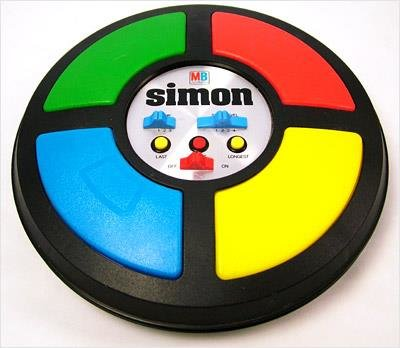

# ENSE 352 2026 Term Project

Trevor Douglas  
Software Systems Lab Instructor  
University of Regina

### Technical Requirements

- Nucleo board.
- Four buttons.
- Four LED's.
- A README file describing what the game is and how to play.

### Beginning Sequence

When starting the game initiate a classic [Cylon Eye Scanner](https://www.youtube.com/watch?v=dv3dUc_G4a0) or [Knight Rider light sequence](https://www.youtube.com/watch?v=oNyXYPhnUIs). Keep this sequence until a user presses a button. This will initiate the first round of gameplay.

### Our Gameplay

Begin the game with one LED for round one. The user will mimic this light by pressing the appropriate button. When the user presses the button, light the corresponding LED. The player only has a limited amount of time to press the button. If the player is successful then move on to round two and add a LED to the sequence. This will continue until round 10.

### Game End

The game ends if one of two ways:

1. Failure Sequence.
2. Game Won.

### Failure Sequence

A failure can happen in one of two ways:

- The player gets the sequence wrong.
- A button is not pressed in time during the repeat sequence. How long? That is up to you as the game designer.

The failure sequence is up to you as the game designer. Create some LED sequence that indicates failure by blinking this failure 4 times. Then the level achieved will be indicated by lighting the 4 bit binary pattern on the LED's. The LED's will remain in this pattern until the player presses any button and a new game will resume.

### Game Won!!

If the player completes 10 rounds successfully then the Game Won sequence will run. This will be all 4 LED's blinking on and off together 4 times. Then the level achieved will be indicated by lighting the 4 bit binary pattern on the LED's. The LED's will remain in this pattern until the player presses any button and a new game will resume.

### Deliverables

Create a Project folder in your Repository and create the Simon project under revision control.  A video demonstrating your gameplay and all the requirements shall be submitted to URCourses.

### Grading
1. Project is worth 20% of lab grade.
2. 10% for Code submission in Repository.
3. 10% for Video submission.